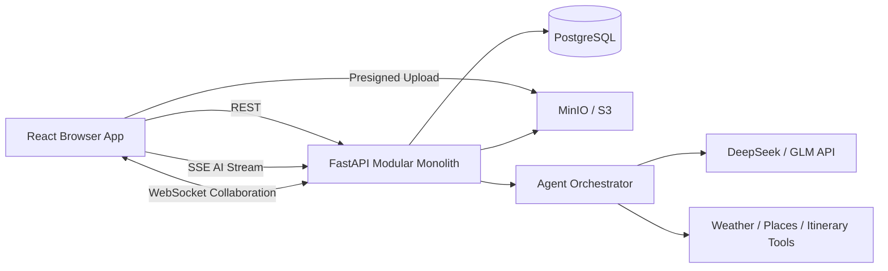

# Travel Copilot MVP 架构与学习计划

> 版本：0.2
>
> 目标：通过一个可实际运行的 AI 旅行助手转向 AI Agent 工程。优先建立可验证的 Agent 核心能力，再扩展实时通信、文件上传和协作功能。

## 1. 项目定位

这个项目首先是一个学习型 MVP，其次才是完整旅游产品。设计时遵循以下原则：

1. 使用真实业务场景承载技术，不为了展示技术强行增加功能。
2. 先完成最小纵向切片，再建立 Agent core 与 eval，之后加入 SSE、文件上传和 WebSocket。
3. 第一版采用模块化单体，不拆微服务。
4. 所有性能优化都要有指标、测量结果和明确瓶颈，不追求抽象的“性能最佳”。
5. AI Provider、文件存储等外部系统通过稳定的内部接口隔离，避免业务代码与供应商 API 紧耦合。

## 2. 用户与核心场景

目标用户是希望规划一次旅行的个人或同行小组。

### 2.1 MVP 功能

- 注册、登录、退出并恢复登录状态。
- 创建旅行计划：目的地、日期、预算、人数和兴趣。
- 与 AI 旅行助手对话。
- 实时看到 AI 文本输出和工具执行状态。
- 将 AI 建议保存为结构化日程。
- 上传机票、酒店订单、PDF 攻略和图片。
- 在时间线和地图中查看行程。
- 分享旅行计划，邀请同行者参与讨论和投票。

### 2.2 暂不实现

- 真实机票或酒店预订。
- 支付。
- 自动购买或代表用户执行高风险操作。
- 多 Agent 自主协作。
- 微服务、Kubernetes 和复杂消息中间件。
- 大规模推荐系统。

## 3. 推荐技术栈

### 3.1 前端

- React 19 + TypeScript + Vite
- React Router：页面路由
- TanStack Query：服务端状态、缓存、失效和重试
- Zod：表单及 API 边界运行时验证
- Tailwind CSS 或 CSS Modules：样式
- MapLibre GL JS：地图展示
- Vitest + React Testing Library：单元与组件测试
- Mock Service Worker（MSW）：模拟 REST、错误和流式响应
- Playwright：端到端测试

状态使用原则：

- 局部交互状态优先使用 `useState` / `useReducer`。
- 服务端数据交给 TanStack Query。
- URL 可表达的筛选条件放入 URL。
- 只有出现真正复杂的跨页面客户端状态时才引入 Zustand。

### 3.2 后端

- Python 3.12
- FastAPI：REST、SSE、WebSocket 和 OpenAPI
- Pydantic：请求、响应和 Agent 工具参数验证
- SQLAlchemy 2：数据访问
- Alembic：数据库迁移
- PostgreSQL：业务数据
- OpenAI-compatible Python SDK：LLM 调用；DeepSeek 默认，GLM 可切换（base_url + model 从环境变量读取）
- pytest：后端测试

### 3.3 本地基础设施

- Docker Compose：统一启动依赖服务
- PostgreSQL：关系型数据
- MinIO：本地 S3 兼容对象存储
- Redis：仅在需要后台任务、跨实例广播或可恢复任务后加入
- Caddy 或 Nginx：后期用于同域反向代理和 TLS

## 4. 总体架构



推荐使用同一站点入口：

```text
https://travel.example.com/       前端页面
https://travel.example.com/api/*  FastAPI
https://travel.example.com/ws/*   WebSocket
```

同域部署可显著简化 Cookie、CORS、CSRF 和本地开发配置。

## 5. 前端模块划分

```text
src/
  app/                 应用入口、Provider、Router
  layouts/             固定应用布局、Sidebar、Content
  routes/              路由页面
  features/
    auth/               登录与用户状态
    trips/              旅行 CRUD
    chat/               消息列表、输入与流处理
    itinerary/          结构化行程
    attachments/        文件上传
    collaboration/      WebSocket 协作
  entities/             User、Trip、Message 等领域类型
  shared/
    api/                HTTP client、生成的 OpenAPI 类型
    components/         通用 UI 组件
    lib/                SSE parser、格式化、错误处理
```

不要让组件直接调用 LLM Provider、拼接数据库结构或解析供应商原始事件。组件只消费应用自己的 API 和领域事件。

## 6. 后端模块划分

```text
app/
  main.py               FastAPI 入口和中间件
  core/                 配置、安全、日志、数据库
  auth/                 用户、密码、Session
  trips/                旅行与成员权限
  conversations/        对话、消息和 Agent Run
  itinerary/            结构化行程
  attachments/          文件元数据和对象存储
  collaboration/        WebSocket 房间
  agent/
    orchestrator.py     Agent 循环
    providers/          DeepSeek / GLM 适配层
    tools/              Weather、Places、Save Itinerary
    events.py           内部流式事件协议
```

API 层负责 HTTP；Service 层负责业务规则；Repository 或数据访问层负责数据库；Provider 层负责外部服务。不要把所有逻辑放进 FastAPI route function。

## 7. 通信协议选择

| 场景 | 协议 | 原因 |
| --- | --- | --- |
| 登录、旅行 CRUD、消息历史 | REST | 标准的一问一答模型 |
| AI 文本和工具状态 | SSE | 服务端单向持续推送，基于普通 HTTP |
| 在线状态、同行讨论、投票 | WebSocket | 客户端和服务端都需主动发送消息 |
| 文件本体 | MinIO/S3 Presigned URL | 避免大文件经过 API 服务 |
| 文件元数据 | REST | 普通结构化数据 |

### 7.1 SSE 与“流式渲染”

这里的流式渲染指 AI token 到达后逐步更新界面，不等同于 React SSR 的 HTML Streaming。

建议事件协议：

```text
run.started
text.delta
tool.started
tool.completed
artifact.updated
run.completed
run.failed
heartbeat
```

事件示例：

```text
event: text.delta
id: 42
data: {"runId":"run_123","messageId":"msg_456","delta":"东京"}

```

前端处理原则：

- 使用 `AbortController` 支持停止生成。
- 不要每个字符触发一次整棵组件树更新。
- 将 delta 放入 buffer，每个动画帧或每 30–50ms 合并提交。
- 使用稳定的 `messageId` 更新单条消息。
- 区分 transport error、Agent error 和 tool error。
- 页面卸载或用户取消时，后端也要取消上游 LLM 请求。

### 7.2 WebSocket 的真实用途

第一版 AI 输出不用 WebSocket。WebSocket 放在协作功能：

- 用户加入或离开 Trip 房间。
- 在线成员状态。
- 同行者对景点投票。
- 行程修改广播。
- 短暂断线后的重连和状态恢复。

## 8. AI Agent 设计

简单 LLM 调用是：用户输入 → LLM 文本输出。

Agent 循环是：

```text
用户输入
→ LLM 决定是否调用工具
→ 后端验证工具名和参数
→ 执行工具
→ 将工具结果返回 LLM
→ LLM 决定继续调用或生成最终回答
```

第一版只提供三个工具：

```text
search_places(destination, interests)
get_weather(destination, date_range)
save_itinerary_item(trip_id, item)
```

每个工具必须具备：

- Pydantic 输入 Schema。
- 明确返回结构。
- 用户和 Trip 权限检查。
- 超时、重试边界和错误映射。
- 结构化日志。
- 修改数据前的用户确认。

Agent 运行必须限制最大步骤数、总时长、token 和成本。LLM API Key 只存后端环境变量，不能进入浏览器或日志。

供应商隔离建议：

```python
class LlmProvider(Protocol):
    async def stream(self, request: LlmRequest) -> AsyncIterator[AgentEvent]: ...
```

业务层消费 `AgentEvent`，而不是直接依赖任一供应商的原始 event 类型。DeepSeek 与 GLM 的差异收敛在 Provider 适配层。

## 9. 核心数据模型

```text
User
Session
Trip
TripMember
Conversation
Message
AgentRun
ToolCall
Attachment
ItineraryItem
```

关系：

```text
User 1—N TripMember N—1 Trip
Trip 1—N Conversation
Conversation 1—N Message
Message 1—N AgentRun
AgentRun 1—N ToolCall
Trip 1—N Attachment
Trip 1—N ItineraryItem
```

`Message` 保存最终稳定消息；`AgentRun` 保存一次生成的状态、耗时、模型和 token 用量；`ToolCall` 保存工具执行轨迹。不要把每个 token 写入数据库。

## 10. API 草案

### 10.1 鉴权

```text
POST /api/auth/register
POST /api/auth/login
POST /api/auth/logout
GET  /api/auth/me
```

### 10.2 Trip

```text
POST   /api/trips
GET    /api/trips
GET    /api/trips/{tripId}
PATCH  /api/trips/{tripId}
DELETE /api/trips/{tripId}
```

### 10.3 对话与 AI

```text
GET  /api/trips/{tripId}/messages
POST /api/trips/{tripId}/runs/stream    SSE 流式生成
POST /api/runs/{runId}/cancel
```

第一版可用 POST + `fetch()` 读取 `ReadableStream`。需要自动重连和任务恢复时，再演进为“POST 创建 Run + GET EventSource 订阅事件”。

### 10.4 文件

```text
POST /api/trips/{tripId}/attachments/upload-intent
POST /api/trips/{tripId}/attachments/complete
GET  /api/trips/{tripId}/attachments
GET  /api/attachments/{attachmentId}/download-url
```

### 10.5 WebSocket

```text
WS /ws/trips/{tripId}
```

## 11. 鉴权与安全

浏览器应用优先使用 opaque Session Cookie，而不是把长期 JWT 放进 `localStorage`。

登录成功时返回：

```http
Set-Cookie: session=<random-token>; HttpOnly; Secure; SameSite=Lax; Path=/
```

安全要求：

- 密码使用 Argon2id 哈希。
- 数据库只保存 Session token 的哈希。
- 所有 Trip、附件和 WebSocket 连接都检查成员权限。
- 修改数据的请求加入 CSRF 防护。
- 登录和 AI 接口做 rate limit。
- 不在日志中记录密码、Cookie、API Key 或完整私人文件内容。
- 服务端验证所有输入，前端验证不能替代服务端验证。
- 上传文件限制大小、MIME、数量和 object key。
- 防止 Prompt Injection 让模型越权调用工具。

## 12. 文件上传与 MinIO

MinIO 是可本地运行、兼容 Amazon S3 API 的对象存储。开发环境将文件存入 MinIO，生产环境可换成 S3。PostgreSQL 保存文件元数据，不保存大文件本体。

核心概念：

- Bucket：对象容器，例如 `travel-attachments`。
- Object Key：文件唯一标识，例如 `users/42/trips/8/uuid.pdf`。
- Presigned URL：具有有限权限和过期时间的临时上传或下载地址。

推荐上传流程：

```text
浏览器提交文件名、大小、MIME
→ FastAPI 检查身份、Trip 权限和文件限制
→ FastAPI 生成 Presigned URL 和随机 object key
→ 浏览器直接 PUT 到 MinIO
→ 浏览器通知 FastAPI 上传完成
→ FastAPI 向 MinIO 验证对象
→ PostgreSQL 保存 Attachment 元数据
→ 后台任务解析 PDF 或图片
```

MinIO 只负责保存文件，不负责病毒扫描、PDF 解析或文字识别。

## 13. 性能设计

先定义指标，再优化：

- 普通 API 本地环境目标 `p95 < 200ms`。
- 记录 AI Time To First Token 和完整生成时间。
- token 更新不触发整个页面重新渲染。
- 长消息列表和长行程列表使用虚拟化。
- 文件由浏览器直传对象存储。
- 用户取消或断开后取消上游 LLM 请求。
- 数据库外键和高频查询条件建立索引。
- 避免 N+1 查询。
- 所有请求记录 `requestId`，所有生成记录 `runId`。
- 设置 HTTP、数据库、工具和 LLM 超时。
- 只对幂等操作进行有限重试，并使用指数退避。

## 14. 测试策略

### 前端

- reducer 和 SSE parser 单元测试。
- MSW 模拟正常流、半途错误、慢流和取消。
- React Testing Library 验证消息和工具状态。
- Playwright 覆盖登录、创建 Trip、AI 流、上传和重连。

### 后端

- pytest 测试权限、Schema、Service 和 API。
- LLM Provider 及外部工具全部使用 fake/mock，并覆盖切换 Provider、超时和错误事件。
- 验证断开连接会取消生成。
- 验证错误不会留下永久 `running` 状态。
- 测试文件大小、MIME 和越权访问。

### Agent eval

- 从首次 Agent loop 开始维护可重复运行的固定场景，不等到项目末期再补“示例问题”。
- 最小场景集覆盖正常工具调用、参数缺失或非法、工具超时/失败、跨用户越权、Prompt Injection、达到最大步骤，以及前端取消。
- 每个场景记录输入、预期终止状态、工具轨迹、耗时、token 和成本；mock 模型用于稳定回归，少量真实 Provider smoke test 用于发现适配漂移。
- eval 用于证明可靠性和控制边界，不把模型措辞完全一致当作通过条件。

### 契约

FastAPI 自动生成 OpenAPI。使用 OpenAPI 生成 TypeScript client/types，并在 CI 中检查生成结果是否与后端契约同步。

## 15. 可观测性

结构化日志至少包含：

```text
requestId
userId（非敏感内部 ID）
tripId
runId
route
statusCode
durationMs
model
toolName
inputTokens
outputTokens
```

需要观察：

- API 错误率和延迟。
- SSE 中断率。
- AI 首 token 延迟。
- Agent 工具成功率。
- 每次 Run 成本。
- 文件上传和解析失败率。

## 16. 分阶段实施

### Phase 0：项目骨架

- 创建 React、FastAPI 和 PostgreSQL。
- 建立 `/healthz`。
- 配置本地代理和环境变量。
- 建立 lint、format、test 和 Docker Compose。

完成标准：浏览器调用 FastAPI 并显示健康状态。

### Phase 1：身份与权限基础

- 注册、登录、退出和 Session Cookie（已在 A 系列提前实施）。
- 建立后续 Trip、会话和 Agent 工具所需的身份边界。
- 定义成员权限检查原则。

完成标准：浏览器能恢复登录，未登录请求被拒，权限检查不依赖前端。

### Phase 2：最小旅行纵向切片

- 创建和读取 Trip。
- 输入一条消息并调用 LLM，先返回非流式答案。
- 保存 Message。

完成标准：从 UI 到数据库、Provider 和 LLM 的完整链路可用。

### Phase 3：Agent 核心与 eval

- Provider 接口与 DeepSeek 默认、GLM 可切换适配。
- 一个只读工具，覆盖 Schema 校验、权限、超时和稳定错误。
- Agent loop 状态机、最大步骤/时长/token、取消和终止状态。
- AgentRun / ToolCall trace、成本和延迟记录。
- 固定 eval 场景：正常、工具失败、越权/注入、达到上限。

完成标准：Agent 能完成一次受控工具调用，失败和超限不会永久挂起，且回归场景可重复运行。

### Phase 4：SSE

- 自定义事件协议。
- 流式文本、工具状态、取消和错误。
- 前端 buffer 更新和重渲染分析。

完成标准：慢流、取消、断网和错误都有明确 UI 状态，且不破坏 Agent 已有的终止语义。

### Phase 5：文件上传

- MinIO、Presigned URL、进度和 Attachment。
- PDF 文本提取作为后台任务。

完成标准：上传不会经过 FastAPI 内存中转，失败可重试。

### Phase 6：WebSocket 协作

- Trip 房间、在线成员、投票和重连。

完成标准：两个浏览器窗口可实时同步投票和在线状态。

### Phase 7：工程与性能

- 补齐测试和可观测性。
- OpenAPI 类型生成。
- 消息虚拟化、数据库索引和性能报告。

### Phase 8：可选 SSR 专项

为公开 Trip 分享页增加 Next.js 或 React Router SSR，学习 HTML streaming、hydration 和 SEO。不要在核心 MVP 尚未闭环时引入第二个服务端渲染框架。

## 17. 面试能力映射

| 能力 | 项目证据 |
| --- | --- |
| React 状态设计 | 局部状态、服务端状态和流状态分层 |
| 网络基础 | REST、SSE、WebSocket、取消和重试 |
| 性能 | token 批处理、虚拟化、Profiler 数据 |
| 安全 | Cookie Session、CSRF、权限和上传校验 |
| 后端基础 | FastAPI、Schema、数据库事务和迁移 |
| AI Agent 工程 | Provider 隔离、tool contract、受控 loop、trace、eval、成本和安全边界 |
| 可靠性与评估 | 最大步骤/超时、终止状态、失败回归场景和可复查指标 |
| 文件系统 | Presigned URL、MinIO/S3、异步解析 |
| 测试 | MSW、Playwright、pytest、契约测试 |
| 架构判断 | 为什么 SSE 不用 WebSocket，为什么先单体 |

## 18. 面试叙述模板

> 我实现了一个 React + FastAPI 的 AI 旅行助手。REST 负责业务数据，SSE 负责 AI 单向流式输出，WebSocket 负责同行者实时协作，Presigned URL 负责文件直传。后端使用 opaque Session Cookie 鉴权，并通过 Provider 接口隔离 DeepSeek/GLM 和供应商原始事件。Agent 循环具备工具 Schema 校验、服务端权限检查、超时、最大步骤、终止状态、执行轨迹和固定 eval 场景。整个系统从模块化单体开始，通过指标和失败回归决定后续优化。

## 19. 开始实现前的决策清单

- [x] 确认第一版只做单用户 Trip，不先做协作。
- [x] 确认前端使用 Vite SPA，SSR 放到后期专项。
- [ ] 确认第一版 LLM 调用先非流式，再升级 SSE；DeepSeek 默认、GLM 可切换。
- [ ] 确认本地使用 PostgreSQL 和 MinIO。
- [x] 确认认证使用 Cookie Session。
- [ ] 定义首批 API Schema 和错误格式。
- [ ] 定义 SSE 事件联合类型。
- [ ] 定义 User、Trip、Message、Run、Attachment 表。
- [x] 为每个 Phase 写清可运行的验收场景。

这些决策随阶段推进持续确认；不要为了补齐清单回退重做已完成的基础设施。
